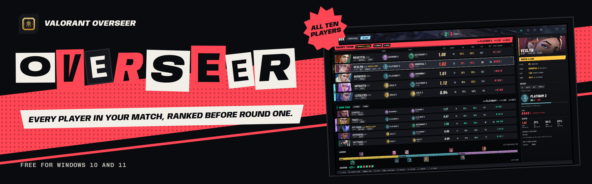
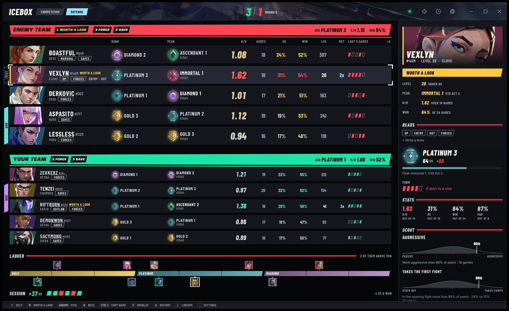
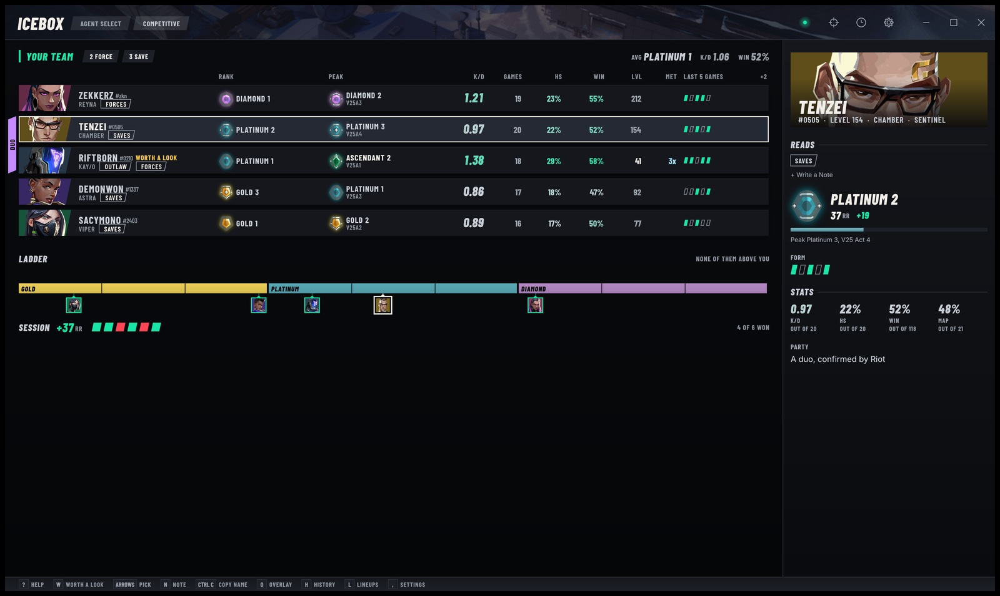
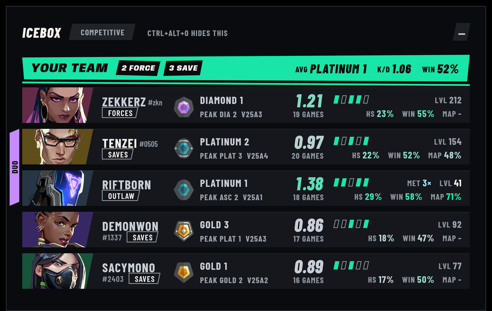
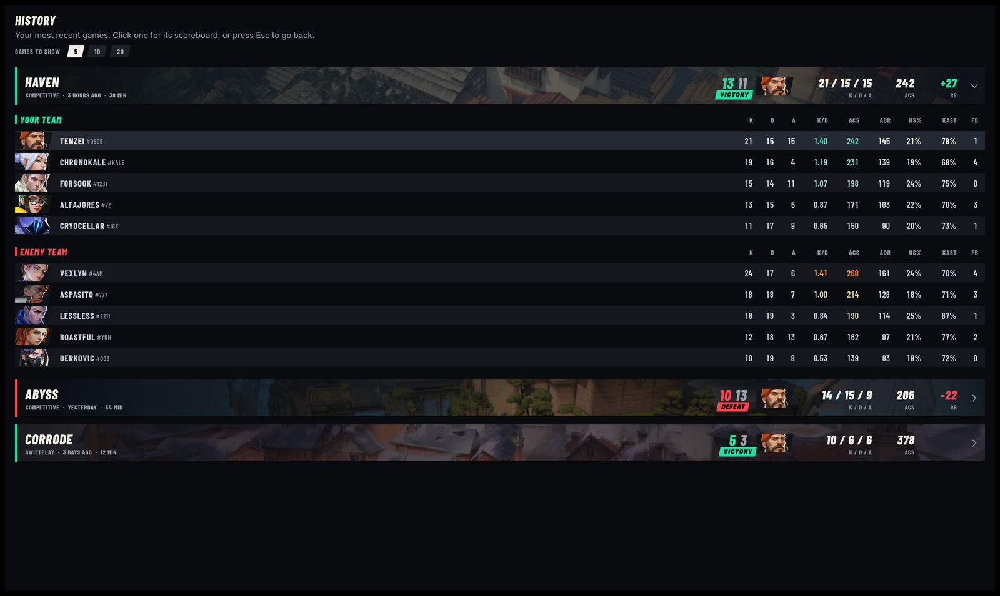
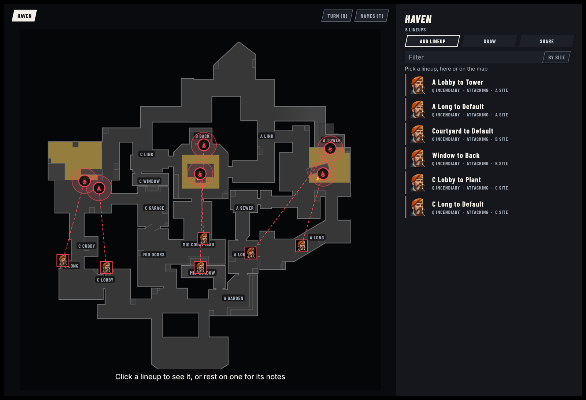

# Valorant Overseer

Valorant Overseer is a match tracker for VALORANT on Windows that runs entirely
on your PC. It shows all ten players in your match with their rank, peak rank,
K/D and win rate, who queued together, and whether an account looks like a
smurf, and Scout sets each player's habits against others on the same agent at
about the same rank. It also keeps your match history, has a lineup planner with clips for
every map, puts an overlay over the game in agent select, and can hide you
from your friends in Riot chat.

**[Download Valorant Overseer for Windows](https://github.com/SomethingObvious/Valorant-Overseer/releases/latest)**

There's more on the [Valorant Overseer site](https://somethingobvious.github.io/Valorant-Overseer/).

## Screenshots

## What It Shows

As soon as agent select opens, a small overlay sits over the game with your
team's ranks, peaks, K/D, recent form and parties. Until someone locks in,
their row lists the three agents they play most and the role those share, like
Duelist, and the blacked out figure in their slot is their main. `Ctrl+Alt+O`,
or any key or mouse button you set in Settings, shows or hides it, and it goes
away once the match loads.

When the match loads, the whole lobby goes on one board with each player's
rank, peak rank and the act they reached it, K/D, headshot rate, win rate,
level, RR and last five games. The other team sits on top under a red band,
since they're the five you can't see in game, and your team sits under a teal
one. Each band counts who tends to force and who saves after a lost round, the
player you have picked gets brackets on its corners, and a tab down the side
joins players who queued together. Press `?` for a Help screen that explains every
colour and mark on the board, along with every key.

Rest the pointer on a player and the panel beside the board opens on their
card, their rank with its RR, their form, the agents they main and who they
play with most. Reads sum up their habits from recent matches, and an account
that looks like a smurf is flagged Worth a Look with the reasons beside it.
Notes and tags you leave on a player come back the next time you meet them.

Under their stats, Scout puts the player's recent games against other players
on the same agent in the same rank band. It names their pace, like Aggressive,
and up to two habits that stand out, each on a curve of those peers with a tip
for playing against it. It also guesses what they'll buy on this kind of round
from the rounds like it they've played, and All Figures opens every line it
worked out. A habit that stands out also shows as a tag on their row, and Tags
in Settings sets which kind of tag comes first and hides any kind or word you
don't want. Games and Within in Settings pick how many recent games each row
reads (5, 10 or 20) and how old they can be.

Under the board, the ladder lays the lobby's ranks out as a strip of plates
that brighten toward the top of each rank. Your team sits below it and the
other team above, each face framed in its team's colour, and faces that land
close together overlap a little instead of hiding each other. Your session's
RR keeps count of the night beneath it, and beside it how far your rating really
moved, which can differ from the matches' own figures after a rank up, derank
protection or a dodge.

Your match history shows each game's score with a Victory or Defeat chip under
it, your K/D/A, ACS and the RR you won or lost. Open one for the full
scoreboard, with ADR, headshot rate, KAST and first bloods for all ten players.

The lineup planner covers every map. Drag from where you stand to where it
lands, pick the agent and the ability, and add a clip from a YouTube link or a
video of your own, trimmed in the app. You can draw on the map, check a
turret's line of sight, and share a map's lineups as a code to paste in chat.
The Sandbox under Draw hides the lineups and keeps nothing, and it has every
agent and the Spike to put on the map while you talk a round through.

Appear Offline hides you from your friends in Riot chat without changing
anything in the game. It restarts the Riot Client and VALORANT to do it, so
finish your match first.

## How It Works

Overseer reads your match from the Riot Client's own local API, the same one
the client uses to show your party, and asks Riot's servers for the recent
games of the players in it. It never touches the game itself: it doesn't read
the game's memory, and it never clicks, types or locks in an agent.

There's no account, no server of its own and no tracking. Agent and map art
comes from valorant-api.com, and nothing about you is sent there. Once a day it
asks GitHub which version is newest, in one small request with nothing about
you in it, and Look for Updates in settings turns that off. It never downloads
or installs anything by itself. Your notes, lineups and history stay in the
install folder, and Your Data in settings opens it.

The window draws nothing while you leave it alone, and asks Windows for the
integrated GPU so VALORANT keeps the faster one.

Scout works from the same recent games and a 1 MB file of peer statistics
that ships with the app, so it doesn't crawl anyone else's history. That
baseline was sampled through one account, which means its percentiles describe
that sample and not every ranked player. Keep in settings holds your party's
games on disk for 7, 14 or 30 days, so a restart doesn't ask Riot for them
again. It keeps at most 200 matches or 64 MiB and drops the oldest first, and
setting it to Off clears it.

## Installing

Overseer runs on Windows 10 and 11. Download `Valorant-Overseer-Setup.exe`,
open it and pick your region. It installs into
`AppData\Local\Programs\Valorant Overseer` with its own copy of Python and
doesn't need admin rights. If Windows says it protected your PC,
click More info, then Run anyway.

Then open VALORANT and join a lobby. It uninstalls from Settings > Apps.

When a new version is out, the footer says so, and its setup updates in place.
It keeps your region, lineups, notes and settings, and running it again
repairs an install.

Lineup clips need yt-dlp and FFmpeg. Setup installs them with winget, and
Update Clip Tools in settings updates them when a link stops downloading.

## Notice

Valorant Overseer isn't made or endorsed by Riot Games. It never touches the
game, but whether third-party tools are allowed is Riot's call, so it can't
promise anything about bans either way.

Working on the code? `crates/README.md` covers that.

## Licence

Overseer is under the [PolyForm Strict License 1.0.0](LICENSE.md). You can use
it for anything noncommercial, but you can't sell it, use it in a business,
share copies of it, or publish a changed version of it.
